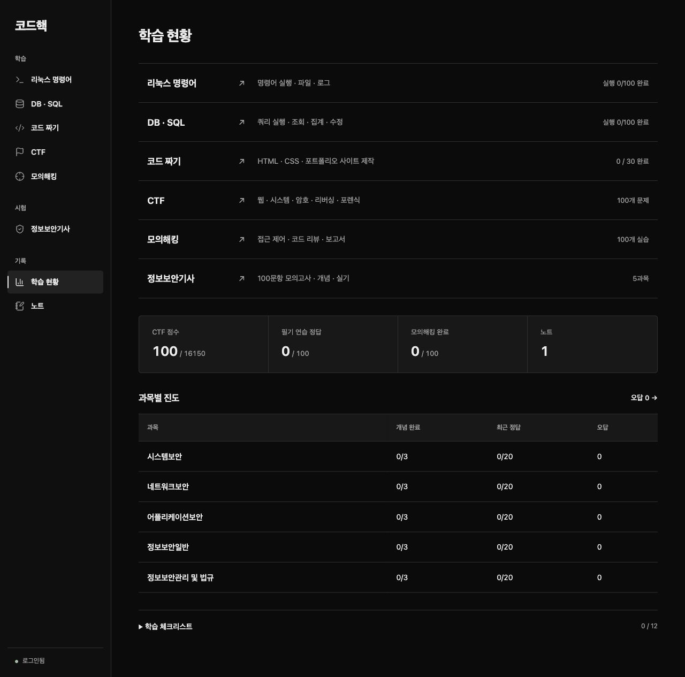
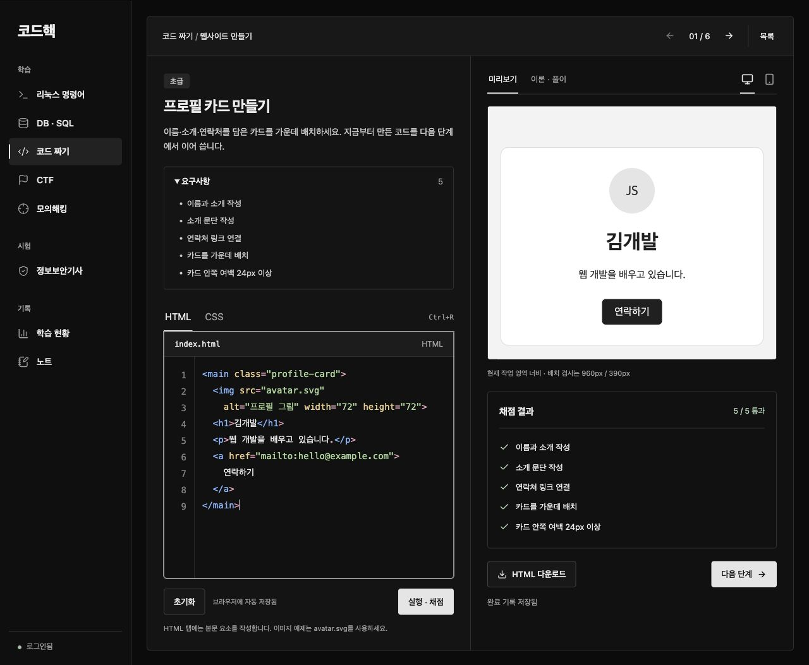
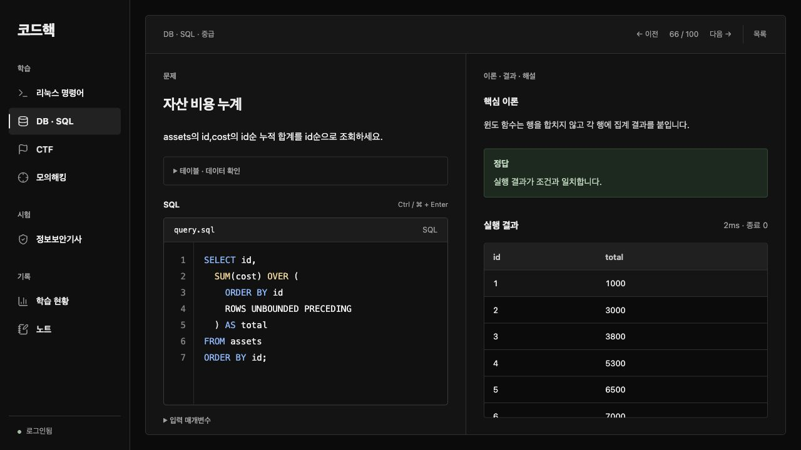
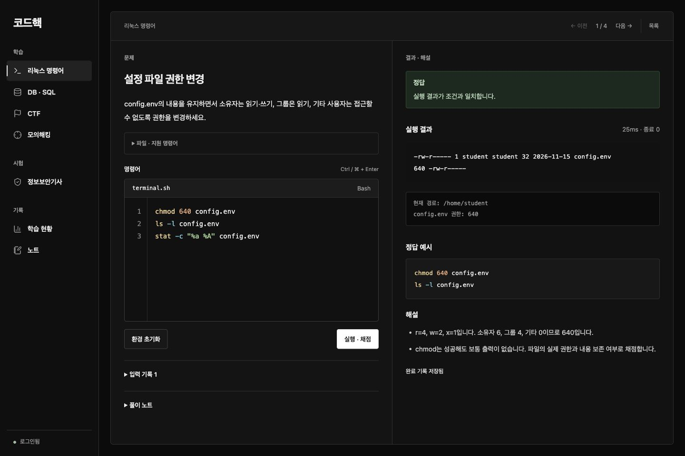
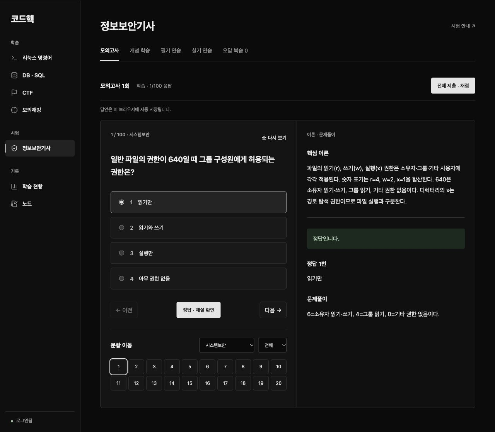
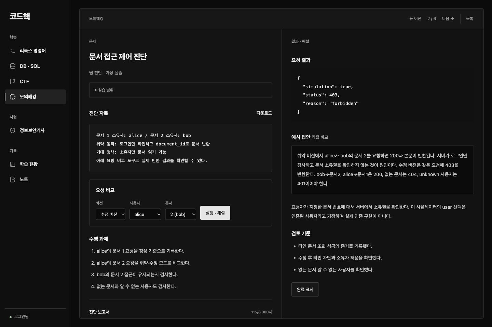

# 코드핵 · CodeHack

**명령어를 실행하고, 보안 문제를 풀고, 근거를 기록하는 학습 워크스페이스.**

리눅스와 SQL을 브라우저에서 직접 실행하고, HTML·CSS로 웹사이트를 만들며 CTF·모의해킹·정보보안기사를 함께 학습합니다. 문제는 왼쪽, 이론과 실행 결과·풀이 해설은 오른쪽에 배치했습니다. 정해진 훈련 기간 없이 원하는 분야부터 시작하고 이어서 풀 수 있습니다.



## 문제 구성

| 분야         | 분량          | 학습 내용                                         | 확인 방식                             |
| ------------ | ------------- | ------------------------------------------------- | ------------------------------------- |
| 리눅스       | 100문제       | 경로·파일·권한·검색·텍스트 처리·로그 분석         | 명령 실행 결과와 파일 상태 채점       |
| DB · SQL     | 100문제       | 조회·조인·집계·서브쿼리·CTE·윈도 함수·트랜잭션    | SQLite 실행 결과와 변경 범위 채점     |
| 코드 짜기    | 30과제        | HTML 12개 · CSS 12개 · 포트폴리오 제작 6단계      | 화면 요소·스타일·반응형 배치 확인     |
| CTF          | 100문제       | 기초·웹·포렌식·암호·리버싱·시스템·네트워크        | 서버 flag 검증, 점수와 해설           |
| 모의해킹     | 100시나리오   | 접근 제어·인증·API·시스템·DB·네트워크·설정·보고서 | 진단 자료, 예시 답안과 검토 기준 비교 |
| 정보보안기사 | 1회차 100문항 | 5과목 × 20문항, 별도 개념 15개·실기 서술 5과제    | 전체 채점, 과목 점수·과락·오답 검토   |

문제 목록은 검색, 분야·난이도·완료 상태 필터와 20개 단위 페이지 이동을 제공합니다. 난이도는 코드핵 내부 학습 기준입니다.

| 난이도 | 기준                                     | 예시                                             |
| ------ | ---------------------------------------- | ------------------------------------------------ |
| 입문   | 기본 개념이나 한 가지 동작 확인          | 파일 읽기, 단순 조회, 증거 기록                  |
| 초급   | 조건·필드·권한을 구분해 적용             | 로그 필터, 조인·집계, 접근 제어 리뷰             |
| 중급   | 여러 단계의 처리나 상태·경계를 함께 검증 | 파이프 조합, 윈도 함수·트랜잭션, API·공급망 진단 |

## 실습 화면

### 코드 짜기 · 웹사이트 제작



- 왼쪽에서 HTML·CSS를 작성하고 **Control + R** 또는 **실행 · 채점**으로 오른쪽 미리보기를 갱신합니다. **Command + R은 브라우저 새로고침**을 유지합니다.
- HTML 12과제, CSS 12과제를 학습한 뒤 프로필 → 메뉴 → 프로젝트 → 연락처 → 반응형 → 완성의 6단계로 포트폴리오 사이트를 만듭니다.
- 제작 단계는 이전에 작성한 코드를 이어받습니다. 이미 작성한 단계는 해당 단계의 코드를 우선 복구하며, 직접 건너뛴 경우에는 직전 단계의 예시 코드를 제공합니다.
- `미리보기 / 이론 · 풀이`를 전환하고, 데스크톱·모바일 화면을 비교합니다. 채점은 실제 요소·스타일과 960px·390px 배치를 확인합니다.
- 코드는 계정별로 이 브라우저에 자동 저장합니다. 완료 기록은 로그인 시 서버에도 저장하며, HTML 다운로드에는 CSS와 연습 이미지가 함께 포함됩니다.

### SQL · 리눅스



SQL은 9개 테이블이 있는 SQLite에서 실행합니다. 조회 결과뿐 아니라 변경 대상, 매개변수 바인딩, 트랜잭션 커밋 여부도 확인합니다.



리눅스는 가상 파일시스템에서 명령을 실행합니다. 파일 생성·복사·삭제, 권한과 원본 보존 여부를 검사하며 실행 중지·환경 초기화·입력 기록을 제공합니다.

### 정보보안기사 모의고사



- **학습 모드:** 시간 제한 없이 오른쪽에서 문항별 이론과 해설을 확인합니다.
- **시험 모드:** 150분 동안 풀고 전체 제출 후 이론과 풀이를 확인합니다.
- 답안·현재 문항·다시 보기 표시는 이 브라우저에 계정별로 자동 저장합니다. 새로고침이나 메뉴 이동 후 이어 풀 수 있습니다.
- 제출 결과는 서버에 저장합니다. 총점, 과목별 정답 수·점수·과락과 최근 20회 응시 기록을 확인합니다. 미응답은 오답으로 처리합니다.
- 평균 60점 이상이며 모든 과목이 40점 이상이면 기준 충족으로 표시합니다. 시험 방식의 기준은 [KCA 공식 안내](https://www.cq.or.kr/qh_quagm01_020.do)를 참고했습니다.

### 모의해킹 · 보고서



제공된 코드·설정·로그에서 원인과 영향을 찾고 수정안과 재검증 계획을 작성합니다. 실습 자료를 내려받을 수 있고, 문서 접근 제어 문제에서는 취약·수정 버전의 요청 결과를 비교합니다. 작성한 보고서와 노트는 저장하거나 Markdown으로 내보낼 수 있습니다.

## 기술 구성

| 영역 | 사용 기술과 역할                                                          |
| ---- | ------------------------------------------------------------------------- |
| 화면 | React · TypeScript · Vinext, 검은색 작업 화면과 구문 강조 편집기          |
| 실행 | Web Worker · just-bash · sql.js(SQLite WASM)                              |
| 서버 | Cloudflare Workers, 사용자별 API와 정답 검증                              |
| 기록 | Drizzle ORM · Cloudflare D1                                               |
| 검증 | Node 테스트 러너, 로컬 API 통합 검사, TypeScript, Prettier, 프로덕션 빌드 |

브라우저 실행용 파일·DB와 학습 기록용 D1은 분리되어 있습니다. 실행 환경은 문제를 닫거나 초기화하면 새로 만들어지며 완료 기록과 저장한 노트는 유지됩니다. CTF 점수, 필기 연습, 모의고사 결과와 직접 검토한 완료 기록도 구분합니다.

## 시작하기

Node.js 22.13 이상과 npm이 필요합니다.

```sh
git clone https://github.com/whdtjr416/codehack.git
cd codehack
npm ci
npm run build
```

처음에는 [로컬 DB 준비](docs/development.md#로컬-db-준비)를 완료한 뒤 실행합니다.

```sh
npm run dev
```

터미널의 Local 주소를 열고 로그인하면 개발 계정으로 학습 기록을 저장합니다. 로컬에서는 외부 계정 인증을 사용하지 않습니다.

```sh
npm run check             # 포맷 · 타입 · 단위 테스트 · 빌드
npm run test:integration  # 로컬 dev 서버가 실행 중일 때 API 검증
```

## 저장소 구조

```text
app/                  페이지 진입점 · API 라우트 · 인증 · 전역 스타일
components/           learning · coding · editor · practice · exams · 공통 UI
lib/
  content/            CTF · 실행 실습 · 코딩 · 기사 · 모의해킹 문제 데이터
  coding/             HTML·CSS 미리보기 · 배치 검사 · 코드 저장
  server/             클라이언트에서 가져올 수 없는 정답 키와 CTF 해설
  runtime/            가상 Bash · SQLite · 실행 Worker
  exams/              모의고사 구성과 채점 규칙
  labs/               문서 접근 제어 시뮬레이터
  editor/             코드 토큰과 구문 강조
  platform/           호스팅 환경 연결
db/                  학습 기록 스키마와 DB 연결
drizzle/             DB 마이그레이션 이력
tests/               unit · integration · helpers
docs/                개발·구조·학습 안내, 이미지와 보고서 양식
examples/            독립 실행 가능한 Python 실습과 D1 참고 예제
public/              실습 다운로드 파일과 정적 자산
scripts/             개발·빌드 도구
```

[구조와 데이터 흐름](docs/architecture.md) · [개발·검증 안내](docs/development.md) · [학습 안내](docs/learning.md) · [보고서 양식](docs/templates/security-report.md)

## 학습 범위

문제와 시나리오는 자체 제작 자료입니다. 실제 기출문제·공식 모범답안이나 전체 출제범위를 대체하지 않습니다. 서술형과 모의해킹 보고서는 예시 답안과 직접 비교하며 자동으로 실무 숙련도를 평가하지 않습니다.

리눅스는 전체 운영체제가 아닌 가상 Bash입니다. 외부 네트워크나 실제 OS 파일에 연결하지 않습니다. 실행은 4초로 제한하고 SQL 결과는 최대 200행을 표시합니다. 모의고사 임시 답안은 다른 기기에 동기화되지 않으며 시험 타이머는 브라우저 기반 개인 연습용입니다. 공개 대회용 부정행위 방지 기능은 포함하지 않습니다.

코드 짜기는 HTML·CSS 정적 사이트 학습용입니다. JavaScript 실행, 외부 리소스 로딩과 폼 전송은 미리보기에서 지원하지 않습니다. 자동 검사는 명시된 요구사항만 확인하므로 디자인·내용·접근성은 직접 검토해야 합니다. 작성한 코드는 다른 기기로 자동 동기화되지 않습니다.

웹사이트 배포는 별도 작업입니다. 다른 호스팅 환경에서는 인증과 DB 연결을 해당 환경에 맞게 구성해야 합니다.

기술 참고: [GNU Bash](https://www.gnu.org/software/bash/manual/bash.html) · [SQLite](https://www.sqlite.org/lang_select.html) · [OWASP WSTG](https://owasp.org/www-project-web-security-testing-guide/). 시험 과목·방식 확인일: 2026-11-16.
